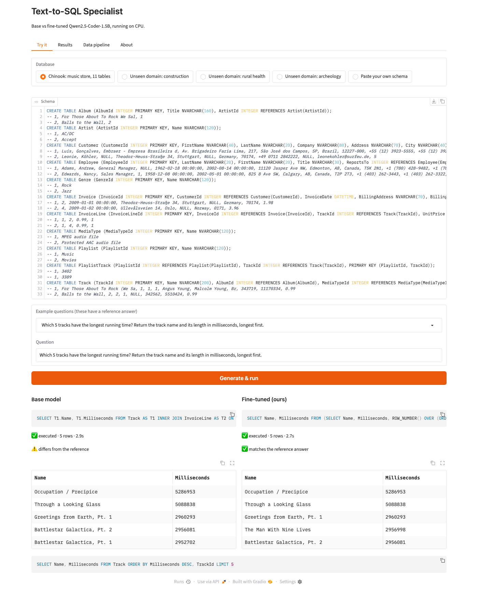

# Text-to-SQL Specialist

**I took Qwen2.5-Coder-1.5B from 54.6% to 62.4% execution accuracy on unseen database domains (n=500, p=0.0002) and from 60% to 70% on a real 11-table database (n=100), with a QLoRA run on a free Colab T4. The whole thing runs on a CPU.**

[Dataset](https://huggingface.co/datasets/parthasaradhi789/text2sql-sqlite-clean) · [Model (GGUF)](https://huggingface.co/parthasaradhi789/text2sql-qwen2.5-coder-1.5b-GGUF) · [LoRA adapter](https://huggingface.co/parthasaradhi789/text2sql-qwen2.5-coder-1.5b-lora) · [Training notebook](notebooks/train_qlora_colab.ipynb) · [Full eval report](reports/eval_results.md) · [Data quality report](reports/data_quality.md)

This repo is the full loop, not just a training run:

```
3 public sources ──► ETL (validate by execution) ──► 9,500-row training set ──► QLoRA on a T4
                                                                                      │
 side-by-side demo (CPU) ◄── GGUF Q4_K_M ◄── execution-based eval on frozen sets ◄────┘
```

## Try it

```bash
git clone https://github.com/wittyparth/text2sql-specialist && cd text2sql-specialist
docker compose up          # CPU only, no keys, no GPU. Open http://localhost:7860
```

No Docker? `./run.sh` picks whatever it finds (Ollama, then llama.cpp, then Docker) and prints each choice. It starts the base model and my fine-tuned model side by side, so you can ask the same question to both.

The UI has four tabs:

| Tab | What it does |
|---|---|
| **Try it** | Pick a database (Chinook, or one of three held-out schemas the model never trained on), click an example or type a question. Both models answer, the SQL is executed read-only, and each result is marked ✓ / ✗ against the reference answer. You can also paste your own `CREATE TABLE` schema. |
| **Results** | The eval tables and charts below, read from `reports/eval_results.json`. |
| **Data pipeline** | The ETL funnel and drop reasons, read from `reports/data_quality.json`. |
| **About** | Method and limits. |

First start downloads two ~1 GB model files once. Measured on 2 CPUs (the Space's size) with both models loaded: a warm question takes **1.1 s p50 on the fine-tuned model and 3.1 s on the base model** (5 Chinook questions each, so a small sample), and 3–4 s for a long window-function query. The base model is slower partly because it writes longer, wordier SQL.



## Results

All numbers come from `reports/eval_results.json`, generated by `make report`. Every model was reached through the same client, **one request at a time** with greedy decoding (batching changes about 5% of greedy outputs, so I never compare runs with different concurrency). The eval sets are frozen and checked by sha256 before every run.

**Execution accuracy** (the predicted SQL is run and its result is compared with the reference result; 95% bootstrap interval):

| Model | Unseen domains, n=500 | Chinook (11 tables), n=100 | Valid SQL (Chinook) | p50 latency (Apple Metal) |
|---|---|---|---|---|
| Qwen2.5-Coder-1.5B base, Q4_K_M | 54.6% [50.4, 59.0] | 60.0% [50.0, 69.0] | 76% | 0.47 s |
| **Fine-tuned, Q4_K_M (what the demo ships)** | **62.4%** [58.2, 66.8] | **70.0%** [61.0, 79.0] | 82% | 0.41 s |
| Fine-tuned, Q8_0 | 64.0% [59.8, 68.2] | 71.0% [62.0, 80.0] | 86% | 0.56 s |
| Fine-tuned, F16 | 64.4% [60.2, 68.6] | 71.0% [62.0, 80.0] | 86% | 0.93 s |
| Base, F16 | 54.4% [50.2, 58.8] | 57.0% [47.0, 67.0] | 71% | 1.13 s |

**Paired comparison, fine-tuned Q4 vs base Q4** (same questions, so the paired test is the right one):

| Set | Δ | 95% CI | McNemar p | base ✓ / tuned ✗ | base ✗ / tuned ✓ |
|---|---|---|---|---|---|
| Unseen domains (n=500) | **+7.8 pts** | [+3.8, +12.0] | **0.0002** | 34 | 73 |
| Chinook (n=100) | +10.0 pts | [−1.0, +21.0] | 0.099 | 10 | 20 |

What I take from these numbers:

- The unseen-domain gain is solid. The Chinook gain is large but **not statistically significant at n=100** (the interval includes zero). I report it as "directionally positive".
- Where it helps: multi-join 25.9% → 48.1% (n=27), set operations 15.4% → 46.2% (n=26), and schema-linking errors fell from 30 to 13 (Gretel) and 24 to 7 (Chinook).
- Where it doesn't: subqueries (50.0% → 50.0%, n=44) and window functions (33.3% → 33.3%, n=36) did not move, and Chinook's `sqlite_specific` slice went 60.0% → 53.3% (n=15, about one question).
- Quantization: Q4_K_M gives up about 2 points on the unseen-domain set against F16 (62.4% vs 64.4%, inside the intervals) and is about 3× smaller and faster. I ship Q4_K_M.
- Per-difficulty tables, the failure-class shift and 15 side-by-side examples (wins and losses) are in [`reports/eval_results.md`](reports/eval_results.md).

On the training run's own validation split (300 held-out-domain questions, Colab, transformers 4-bit): base 57.0% (43 queries did not execute) → fine-tuned 69.3% (11 did not execute).

## The data story (ETL)

The sources are Gretel `synthetic_text_to_sql` (105,851 rows), `b-mc2/sql-create-context` (78,577) and the Chinook sample database, all at pinned revisions. The main finding: **about a quarter of Gretel's labelled queries do not run in SQLite** (DDL and `UPDATE` rows mislabelled as SELECT, MySQL/Postgres functions, ambiguous columns, missing tables). Training on them teaches a model to write SQL that fails, so every row is executed before it is allowed in.

| Stage | Gretel | sql-create-context |
|---|---|---|
| extracted | 105,851 | 78,577 |
| in scope (a single SELECT) | 94,728 | 78,577 |
| runs as written | 72,090 | 76,910 |
| runs after dialect repair (sqlglot) | +5,961 | +559 |
| after filters, dedup, leakage guard | 77,668 | 77,466 |

Every dropped row has a reason code (`NOT_SELECT` 10,626, `SQL_NO_SUCH_COLUMN` 5,253, `SQL_SYNTAX` 4,148, …) with real examples in [`reports/data_quality.md`](reports/data_quality.md).

What the pipeline does that a notebook script wouldn't:

| Property | How it is done | How to see it |
|---|---|---|
| **Validated by execution** | Each example's schema is loaded into an in-memory SQLite and the query is run under a read-only authorizer with a 2 s timeout. | `make pipeline`, then the funnel in the report |
| **Repair before drop** | MySQL/Postgres SQL is transpiled with sqlglot plus a custom rewrite (`YEAR(x)` → `CAST(STRFTIME('%Y', x) AS INT)`, week intervals, …). A leftover `INTERVAL` counts as a failed repair, and the result is re-executed. | "runs after dialect repair" row |
| **Idempotent and incremental** | Content-hash ids, atomic writes, and processed keys derived from the validated parquet. | `make pipeline-demo-incremental`: the second run reports `new=0` and produces byte-identical outputs |
| **Leakage-safe** | The split is by **domain**, not by row: the 10 test and 5 val domains never appear in train (asserted as an empty intersection). A guard then removes any exact duplicate that crosses a split (42 rows removed). | `domain intersection` assertion in the pipeline |
| **One schema format** | Schemas are re-serialized canonically (stable order, quoted identifiers, composite keys as table constraints), so the training prompt and the serving prompt are the same bytes. | `tests/test_parity.py` |
| **Distractor augmentation** | 35% of training rows get extra unrelated tables so the model copes with the long schema of a real database. These rows are re-executed to prove the label is unchanged (3,293 added, 0 failed re-execution). | augmentation table in the report |
| **Observable** | A per-stage funnel report with versions, git SHA and a config hash. | `reports/data_quality.md` |

Output: 9,500 training rows (8,000 Gretel + 1,500 sql-create-context), 300 validation rows, and a frozen 500-question eval set stratified by difficulty with a minimum of 25 per class. The dataset, with a card citing sources and licences, is on the Hub.

## Training

QLoRA with Unsloth and TRL on a free Colab T4. The notebook that ran is committed: [`notebooks/train_qlora_colab.ipynb`](notebooks/train_qlora_colab.ipynb).

| | |
|---|---|
| Base model | `Qwen2.5-Coder-1.5B-Instruct`, loaded in 4-bit NF4 |
| Adapter | LoRA r=16, alpha=32, all attention and MLP projections: **18.46M trainable parameters (~1.2% of the 1.54B model)** |
| Data | 9,500 examples, 1 epoch = 594 optimizer steps (batch 8 × accumulation 2) |
| Optimizer | AdamW 8-bit, LR 2e-4, cosine schedule, 3% warmup, fp16 (the T4 has no bf16) |
| Loss | **on the SQL answer only** (`train_on_responses_only`). The notebook asserts the mask: the decoded labels are the SQL plus `<|im_end|>`, nothing of the schema or question. |
| Eval loss | 0.196 → 0.182 → 0.174 → 0.169 → **0.166** over steps 100–500. It fell at every checkpoint, so no overfitting in one epoch. |
| Run | 594 steps in **25.8 minutes** (1,546 s), mean train loss 0.222. [W&B run](https://wandb.ai/parthasaradhimunakala-parthasaradhi-site/text2sql-specialist/runs/379av0n3) |
| Cost | $0 (Colab free tier, one T4) |
| Output | LoRA adapter, merged model exported to GGUF (F16, Q8_0, Q4_K_M) and pushed to the Hub |

## Evaluation method

- **Execution accuracy, not exact match.** Two different SQL strings can be equally right. The prediction and the reference are both executed and their results compared after normalization: column order is ignored, `94` equals `94.0`, dates compare as dates, floats within tolerance, and row order only matters when the question asks for ordering.
- **Held-out by domain.** The unseen-domain set comes from domains that were excluded from training entirely. Chinook is a separate, real 11-table schema with 100 questions. The questions and reference SQL were drafted with an LLM and every reference was executed against the database (100/100 run); a human spot-check of 20 items is part of the review process.
- **Statistics, not a single number.** Bootstrap confidence intervals (2,000 resamples) on every accuracy, and exact McNemar and paired-bootstrap tests for model comparisons. Every percentage in the reports shows its n.
- **Safe execution.** Predicted SQL runs on a read-only connection with an authorizer that allows only SELECT. A write query is blocked and scored wrong, never executed.
- **Failures are classified** (schema linking, wrong projection, wrong row count, dialect, syntax, …) so the report shows *what* changed, not just how much.
- **Endpoint errors are not model errors.** A timeout or a 500 is retried with backoff and then recorded as `ENDPOINT_ERROR`, never scored as bad SQL. The frozen eval file is verified by sha256 before a run starts.
- **Sanity check of the harness.** The deterministic base-model prototype scored 59% on Chinook; the final harness reproduces 60% (the allowed ±1 for a different llama.cpp build).

## Design decisions

The short versions:

I picked Qwen2.5-Coder-1.5B over the newer small models because it is a plain dense model that trains with QLoRA on a T4 without surprises. The newer hybrid architectures gave me friction on that GPU and had weaker tooling.

I fine-tuned instead of using RAG or prompting because the gap here is behaviour: SQLite dialect, picking the right columns, returning only SQL. RAG is for knowledge that changes, and this isn't that. Prompting a bigger model is the baseline to beat, and a 1.5B model that runs on a laptop CPU is cheaper to serve than any API.

About a quarter of Gretel's queries don't run. Dropping all of them throws away good examples, and fixing them blindly teaches wrong SQL. So I repair with sqlglot, run the result again, and drop whatever still fails.

The split is by domain. With a random row split the same schema ends up in train and test, and the score mostly measures memorization.

Training, eval and the app all build the prompt with the same function and the same canonical schema text, so the model sees identical bytes everywhere. It also lets llama.cpp cache the schema prefix, which took a warm request from 12.4 s to 1.3 s on 2 CPUs.

I serve GGUF files with llama.cpp because it costs nothing and speaks the OpenAI API, so the eval client, the app, Ollama and OpenRouter all use the same code path.

Scope is SQLite, SELECT only, one turn. I'd rather measure that properly than claim more.

## What I would do next

- **DPO with execution feedback.** Sample several queries per question, run them, and use "result matches" vs "does not" as the preference signal.
- **Harder, larger schemas** (BIRD, Spider) to target the subquery and window-function gaps this run did not move.
- **MinHash near-duplicate removal** and **orchestration** (Dagster or Airflow) once the sources are scheduled rather than one-off.
- **A GPU serving path** (vLLM) only if traffic ever needed it.

## Reproduce everything

```bash
make setup          # uv sync (Python 3.12)
make test           # ruff + 118 tests, under 30 s, no network
make pipeline       # ETL: sources -> data/processed + reports/data_quality.md
make pipeline-demo-incremental   # proves the second run does no new work
make eval-all       # every model x both sets (needs: brew install llama.cpp), then the report
make report         # rebuild reports/eval_results.{md,json} and figures
make up             # docker compose up
```

Training is the notebook: open [`notebooks/train_qlora_colab.ipynb`](notebooks/train_qlora_colab.ipynb) in Colab, select a T4, and add `HF_TOKEN` (and optionally `WANDB_API_KEY`) as Colab secrets.

```
src/text2sql/
  prompt.py  schema.py  sqlexec.py   # the shared contract: prompt, canonical schema, safe execution
  etl/      # extract, map, validate, repair, filter, dedup, split, augment, load
  eval/     # client, run, score, error classes, compare (report generator)
  app/      # Gradio UI, side-by-side core, warmup
configs/    # pipeline, train, eval (with the frozen sha256s)
data/       # demo databases and the frozen eval sets
docker/     # app and Space images;  ollama/  Modelfiles;  run.sh
reports/    # generated data-quality and eval reports plus figures
```

## Limitations

- Trained on synthetic questions. Gretel's labels are generated, and some of them are simply wrong, so the "unseen domain" score has a noise ceiling (a manual audit of the failures is in the report).
- Chinook has n=100, so its intervals are wide, and its gain is not significant on its own.
- SQLite SELECT only, single turn, no clarifying questions. It does not use the data values, only the schema.
- The latency column in the results table is Apple Metal, for comparing models on the same machine. What a stranger sees on a CPU is the 2-CPU figure in *Try it*.

## Licences and credits

Code: Apache-2.0 (see `LICENSE`). The model follows Qwen2.5-Coder's Apache-2.0 licence. Data: [Gretel synthetic_text_to_sql](https://huggingface.co/datasets/gretelai/synthetic_text_to_sql) (Apache-2.0), [b-mc2/sql-create-context](https://huggingface.co/datasets/b-mc2/sql-create-context) (CC-BY-4.0), [Chinook](https://github.com/lerocha/chinook-database) (Chinook licence). Built on Qwen2.5-Coder, Unsloth, TRL, sqlglot, llama.cpp and Gradio.
