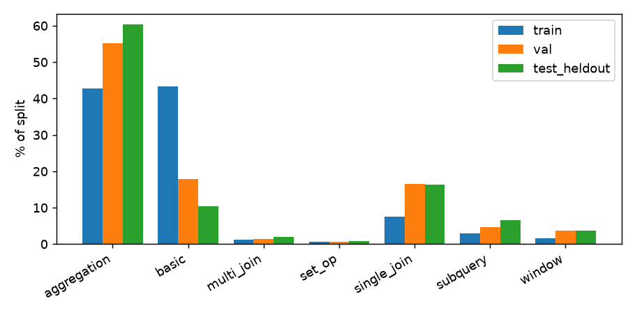
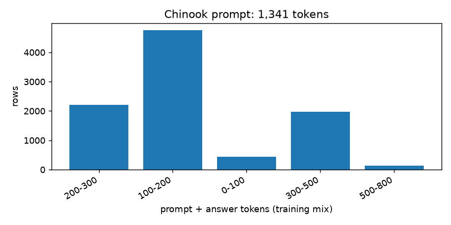
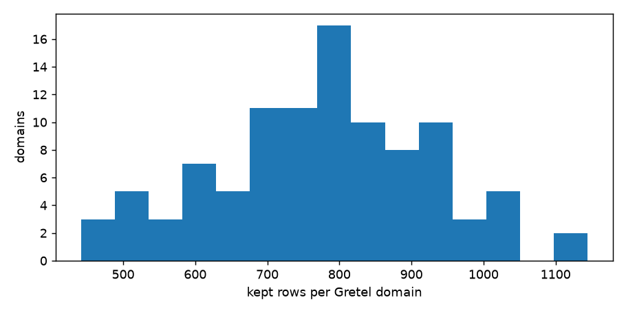

# Data quality report

_Generated by `python -m text2sql.etl.pipeline`; do not edit by hand._

- run `0ae2cb88` at 2026-11-13T03:46:50+00:00, git `c6abd86`, config `3d9e9a417a04`
- python 3.12.13, sqlglot 30.31.0, pyarrow 26.0.1
- source revisions: gretel `740ab236e645`, sqlcc `9d80a6a118b8`, chinook `v1.4.5`

## 1. Funnel

| Stage | gretel | sqlcc |
|---|---|---|
| extracted | 105,851 (100.0%) | 78,577 (100.0%) |
| mapped | 105,851 (100.0%) | 78,577 (100.0%) |
| in scope (SELECT) | 94,728 (89.5%) | 78,577 (100.0%) |
| context loaded | 92,852 (87.7%) | 78,283 (99.6%) |
| executes (raw) | 72,090 (68.1%) | 76,910 (97.9%) |
| executes (repaired) | 5,961 (5.6%) | 559 (0.7%) |
| passes filters | 77,710 (73.4%) | 77,469 (98.6%) |
| after dedup | 77,710 (73.4%) | 77,466 (98.6%) |
| after leakage guard | 77,668 (73.4%) | 77,466 (98.6%) |
| split: train | 66,929 (63.2%) | 77,466 (98.6%) |
| split: val | 3,757 (3.5%) | 0 (0.0%) |
| split: test_heldout | 7,024 (6.6%) | 0 (0.0%) |
| sampled | 8,000 (7.6%) | 1,500 (1.9%) |

Percentages are of rows extracted.

## 2. Drop reasons

| Code | Rows | % of extracted |
|---|---|---|
| NOT_SELECT | 10,626 | 5.76% |
| SQL_NO_SUCH_COLUMN | 5,253 | 2.85% |
| SQL_SYNTAX | 4,148 | 2.25% |
| SQL_NO_SUCH_TABLE | 3,731 | 2.02% |
| CTX_LOAD_FAILED | 2,170 | 1.18% |
| SQL_NO_SUCH_FUNCTION | 1,212 | 0.66% |
| SQL_AMBIGUOUS | 680 | 0.37% |
| SQL_OTHER | 591 | 0.32% |
| MULTI_STATEMENT | 497 | 0.27% |
| TIME_RELATIVE_HARDCODED | 341 | 0.18% |
| LEAKAGE_OVERLAP | 42 | 0.02% |
| DUP_CROSS_SOURCE | 2 | 0.0% |
| DUP_CONFLICTING_LABEL | 1 | 0.0% |

Three real examples per code:

**NOT_SELECT**
- Create a table for employee demographics  
  `CREATE TABLE EmployeeDemographics (EmployeeID INT PRIMARY KEY, Age INT, Gender VARCHAR(10), Ethnicity VARCHAR(20), Department VARCHAR(20))`
- Delete the record for the Downtown area from the InclusiveHousing table.  
  `DELETE FROM InclusiveHousing WHERE area = 'Downtown'`
- Update the "country" column of the "military_exercises" table to "Canada" for records where the "exercise_year" is 2018  
  `UPDATE military_exercises SET country = 'Canada' WHERE exercise_year = 2018`

**SQL_NO_SUCH_COLUMN**
- What is the average price of eco-friendly materials from Latin American suppliers in 2020?  
  `SELECT AVG(price) as avg_price FROM materials WHERE type = 'Eco-friendly' AND origin LIKE 'Latin%' AND YEAR(dates.date) = 2020` -> `no such column: dates.date`
- What is the average mass of all space probes launched by NASA?  
  `SELECT AVG(mass) FROM space_probes WHERE country = 'USA' AND type = 'Space Probe'` -> `no such column: type`
- How many new garment types have been introduced in the African market in the last 6 months?  
  `SELECT COUNT(*) as num_new_garment_types FROM garment_releases WHERE region = 'Africa' AND release_date >= DATEADD(month, -6, CURRENT_TIMESTAMP)` -> `no such column: month`

**SQL_SYNTAX**
- What is the average number of hotels that adopt hospitality AI per month in Canada?  
  `SELECT AVG(EXTRACT(MONTH FROM signup_date)) FROM hotels WHERE country = 'Canada' AND ai_adoption = true GROUP BY EXTRACT(MONTH FROM signup_date)` -> `near "FROM": syntax error`
- What is the total value of trades executed by the trading desk in London?  
  `SELECT SUM(value * currency_rate) FROM trades t JOIN currency_rates cr ON t.currency = cr.currency WHERE t.desk = 'London' AND t.trade_date >= CURRENT_DATE - INTERVAL '1 month'` -> `near "'1 month'": syntax error`
- How many refugees were supported by each organization by age group and gender in Q1 2021?  
  `SELECT organization_id, gender, age_group, COUNT(*) as supported_refugees FROM (SELECT organization_id, gender, CASE WHEN age <= 17 THEN 'Minor' WHEN age BETWEEN 18 AND 64 THEN 'Adult' ELSE 'Senior' E` -> `near "FROM": syntax error`

**SQL_NO_SUCH_TABLE**
- Identify the indigenous communities in the Arctic region with the highest and lowest average annual temperatures.  
  `SELECT community_name, MAX(avg_temp) AS highest_avg_temp, MIN(avg_temp) AS lowest_avg_temp FROM community_temp_data WHERE community_name IN (SELECT community_name FROM communities WHERE region LIKE '%` -> `no such table: communities`
- Show the total assets under management (AUM) for each investment strategy.  
  `SELECT cs.strategy, SUM(value) AS total_aum FROM client_strategy cs JOIN clients c ON cs.client_id = c.client_id JOIN assets a ON c.client_id = a.client_id GROUP BY cs.strategy` -> `no such table: clients`
- What dispensaries are part of the social equity program 'Minority-owned' that was approved in 2020?  
  `SELECT d.name, e.program FROM dispensary d INNER JOIN equity e ON d.id = e.dispensary_id WHERE e.program = 'Minority-owned' AND e.approved_date BETWEEN '2020-01-01' AND '2020-12-31'` -> `no such table: dispensary`

**CTX_LOAD_FAILED**
- List all healthcare providers with mental health coverage score greater than or equal to 0.9  
  `SELECT * FROM healthcare.MentalHealthParity WHERE mental_health_coverage >= 0.9` -> `unknown database healthcare`
- How many settlements does each claim correspond to? List the claim id and the number of settlements.  
  `SELECT T1.Claim_id, COUNT(*) FROM Claims AS T1 JOIN Settlements AS T2 ON T1.claim_id = T2.claim_id GROUP BY T1.claim_id` -> `duplicate column name: claim_id`
- How many traffic violation tickets were issued by police officers in the 'Metropolitan' region in the month of January?  
  `SELECT COUNT(*) FROM Government.Violation WHERE officer_name IN (SELECT name FROM Government.Police WHERE region = 'Metropolitan') AND issue_date BETWEEN '2022-01-01' AND '2022-01-31'` -> `unknown database Government`

**SQL_NO_SUCH_FUNCTION**
- List the number of successful and failed satellite deployments by 'China' in the last 10 years?  
  `SELECT country, year, SUM(CASE WHEN deployment_status = 'successful' THEN 1 ELSE 0 END) AS successful_deployments, SUM(CASE WHEN deployment_status = 'failed' THEN 1 ELSE 0 END) AS failed_deployments F` -> `no such function: DATEADD`
- How many public transportation trips were taken in each district for the last 3 months?  
  `SELECT District, COUNT(*) as Trips, DATE_TRUNC('month', TripDate) as Month FROM Trips WHERE TripDate >= DATEADD(month, -3, CURRENT_DATE) GROUP BY District, Month` -> `no such function: DATE_TRUNC`
- What is the correlation between spacecraft manufacturing costs and spacecraft component quantities?  
  `SELECT CORR(SpacecraftManufacturing.cost, SpacecraftComponents.quantity) FROM SpacecraftManufacturing INNER JOIN SpacecraftComponents ON SpacecraftManufacturing.id = SpacecraftComponents.id` -> `no such function: CORR`

**SQL_AMBIGUOUS**
- What is the percentage of teachers who have completed professional development courses in each district, ordered by the percentage?  
  `SELECT district_id, district_name, AVG(completed_pd_course) * 100.0 as pct_completed FROM districts JOIN teachers ON districts.district_id = teachers.district_id GROUP BY district_id, district_name OR` -> `ambiguous column name: district_id`
- What is the average sustainability score of factories in South Asia by country?  
  `SELECT country, AVG(sustainability_score) FROM factories JOIN country_regions ON factories.country = country_regions.country WHERE region = 'South Asia' GROUP BY country` -> `ambiguous column name: country`
- What is the total number of songs for each artist?  
  `SELECT ArtistName, COUNT(SongName) OVER (PARTITION BY ArtistID) AS SongCount FROM Artist JOIN Song ON Artist.ArtistID = Song.ArtistID` -> `ambiguous column name: ArtistID`

**SQL_OTHER**
- What is the average temperature per day for each sensor in the 'sensor_data' table?  
  `SELECT sensor_id, TRUNC(reading_time, 'DD') reading_day, AVG(temperature) OVER (PARTITION BY sensor_id, TRUNC(reading_time, 'DD')) FROM sensor_data` -> `wrong number of arguments to function TRUNC()`
- Identify the top 3 crops with the highest yield in 2022.  
  `SELECT CropName, ROW_NUMBER() OVER (ORDER BY Yield DESC) as Rank FROM Crop WHERE Year = 2022 HAVING Rank <= 3` -> `HAVING clause on a non-aggregate query`
- Identify the top 3 districts with the highest crime rate in New York City.  
  `SELECT district_name, total_crimes, RANK() OVER (ORDER BY total_crimes DESC) district_rank FROM nyc_districts WHERE district_rank <= 3` -> `misuse of aliased window function district_rank`

**MULTI_STATEMENT**
- List the programs that had the highest and lowest impact in terms of funds raised in 2020?  
  `SELECT program_name, funds_raised FROM programs WHERE program_start_date <= '2020-12-31' AND program_start_date >= '2020-01-01' ORDER BY funds_raised DESC LIMIT 1; SELECT program_name, funds_raised FR`
- Insert new music festival data and calculate the total revenue for each festival.  
  `INSERT INTO festivals (festival_id, festival_name, city, revenue) VALUES (3, 'Glastonbury', 'Pilton', 300000.00), (4, 'Summerfest', 'Milwaukee', 125000.00); SELECT festival_name, SUM(revenue) AS total`
- What are the least popular vegetarian menu items in the Asia-Pacific region?  
  `SELECT m.item, SUM(s.quantity) as total_sold FROM menus m INNER JOIN sales s ON m.menu_id = s.menu_id WHERE m.is_vegetarian = true GROUP BY m.item ORDER BY total_sold ASC; SELECT region FROM sales GRO`

**TIME_RELATIVE_HARDCODED**
- Identify the number of tunnels in the city of London that have been built in the last 5 years and their respective construction companies.  
  `SELECT COUNT(*), construction_company FROM tunnel WHERE city = 'London' AND construction_date >= '2016-01-01' GROUP BY construction_company`
- Count the number of visitors from historically underrepresented communities who engaged with museums in the last year.  
  `SELECT COUNT(*) FROM Visitor_Engagement WHERE museum IN ('National Museum of African American History and Culture', 'American Indian Museum', 'National Museum of the American Latino') AND date >= '202`
- Which artworks were added in the last week of 2021?  
  `SELECT * FROM artworks WHERE added_date >= '2021-12-26' AND added_date <= '2021-12-31'`

**LEAKAGE_OVERLAP**
- What is the total number of volunteers in each program?  
  `SELECT program, COUNT(*) FROM Volunteers GROUP BY program`
- What is the total donation amount for each region?  
  `SELECT region, SUM(donation_amount) FROM donations GROUP BY region`
- What's the average donation amount from donors in the US?  
  `SELECT AVG(donation_amount) FROM donors WHERE country = 'USA'`

**DUP_CROSS_SOURCE**
- What is the average age of all artists?  
  `SELECT AVG(Age) FROM artist`
- What is the name of the most expensive product?  
  `SELECT Product_Name FROM PRODUCTS ORDER BY Product_Price DESC LIMIT 1`

**DUP_CONFLICTING_LABEL**
- What is the sexual abuse rate where the conflict is the Burundi Civil War?  
  `SELECT MAX(sexual_abuse_1) FROM table_15652027_1 WHERE conflict = "Burundi Civil War"`

## 3. Repairs

Rows recovered by sqlglot dialect repair: **6,520** (mysql: 6,216, postgres: 304).

Most frequently rewritten functions: `date_sub` (2644), `year` (2200), `curdate` (897), `month` (513), `date_format` (385), `datediff` (334), `now` (287), `current_date` (109), `current_timestamp` (54), `date_add` (32)

## 4. Split integrity

- test_heldout domains (10): archeology, charitable organizations, chemicals, construction, entertainment industry, fashion retail, fitness industry, rural health, sports, trade unions
- val domains (5): arctic research, blockchain, manufacturing, oil and gas, public transportation
- train domains: 85
- domain overlap between splits: **none** (asserted in code)
- leakage guard: **42** train/val rows removed

## 5. Eval and training sets

| Set | n | By class |
|---|---|---|
| gretel_heldout | 500 | aggregation: 237, basic: 60, multi_join: 27, set_op: 26, single_join: 70, subquery: 44, window: 36 |
| gretel_val | 300 | aggregation: 162, basic: 64, multi_join: 4, set_op: 3, single_join: 43, subquery: 11, window: 13 |
| chinook | 100 | easy: 25, hard: 25, medium: 35, sqlite_specific: 15 |

Training mix: {'train': 9500, 'val': 300, 'test_heldout': 500}. Distractor augmentation: 3,293 rows augmented (34.7% of the training mix), 0 failed re-execution and were kept un-augmented.

Chinook prompt size for comparison: 1,341 tokens.

## 6. Stages

| Stage | in | out | seconds |
|---|---|---|---|
| ingest (map + validate + canonicalize) | 184428 | 155520 | 22.9 |
| filters | 155520 | 155179 | 0.8 |
| dedup | 155179 | 155176 | 0.9 |
| split + leakage guard | 155176 | 155134 | 0.5 |
| sample + augment | 9500 | 9500 | 1.5 |

Incremental: new=184428, skipped=0

## 7. Figures

